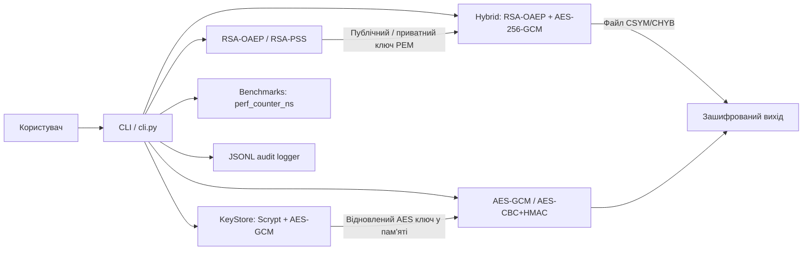

# Архітектура й потоки даних

## Контейнери

- `CSYM | uint16 header_len | canonical UTF-8 JSON | encrypted data | authentication tag`.
- `CHYB | uint16 header_len | JSON | RSA-OAEP(wrapped AES-256 key) | AES-GCM ciphertext+tag`.
- Заголовок AES прив'язаний як AAD або HMAC-вхід; будь-яка зміна salt, IV/nonce, key-id має бути виявлена.
- Для CBC окремий 256-bit MAC-ключ виводиться через HKDF зі спільного майстер-ключа, *не* записується в контейнері.
- Ключі AES зберігаються окремими зашифрованими версіями: Scrypt(password, random salt) → AES-GCM encrypted master key.
